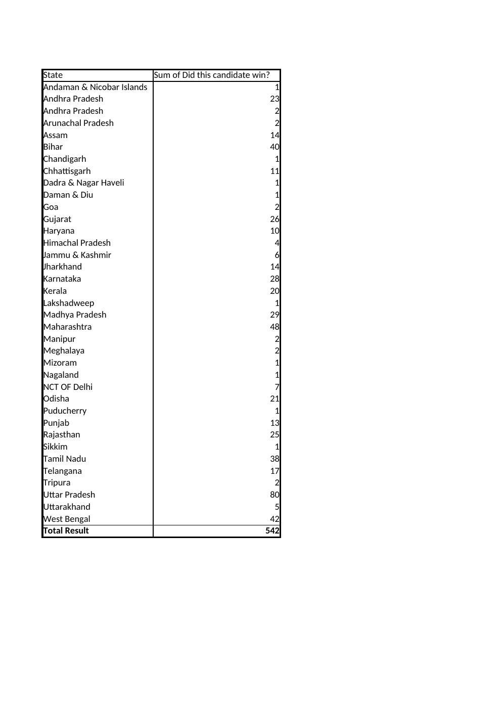

# 2019 Indian Election Analysis Dashboard

## Project Overview
An interactive **Microsoft Excel dashboard** built to analyze 2019 election results using cleaned data, Pivot Tables, PivotCharts, KPIs, and slicers.

## Tools & Techniques
- Microsoft Excel
- Data Cleaning
- Pivot Tables
- PivotCharts
- Excel Slicers
- KPI Reporting
- Data Analysis & Visualization

## Workbook Structure
The workbook contains the following analysis sheets:

- `Dashboard` — interactive dashboard
- `Clean_Data` — cleaned/processed election data
- `2019_Results` — source election results
- `Pivot_Analysis` — pivot-based analysis
- `Party_Analysis` — party-level analysis
- `State_Vote_Analysis` — state-wise vote analysis
- `Sum of Total Votes` — total-vote analysis

## Dashboard Analysis
The dashboard presents:
- Total votes
- Total constituencies
- Total candidates
- Total parties
- Top parties by seats won
- State-wise total votes
- Top parties by total votes
- Interactive state filtering
- Key insights

## Key Skills Demonstrated
- Data cleaning and preparation
- Pivot-based analysis
- Aggregation and comparison
- Interactive dashboard development
- KPI design
- State-wise and party-wise analysis
- Data storytelling

## Preview

## How to Use
1. Download `2019_Indian_Election_Analysis.xlsx`.
2. Open the workbook in Microsoft Excel.
3. Go to the `Dashboard` sheet.
4. Use the slicer to interact with the analysis.

